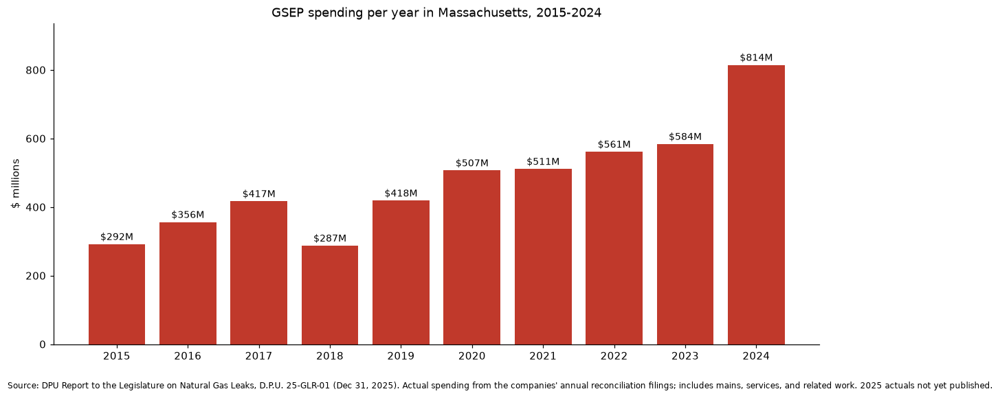
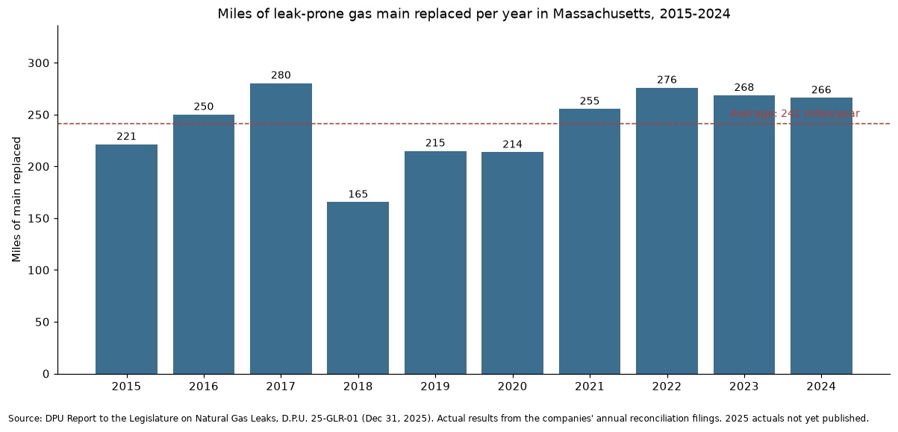
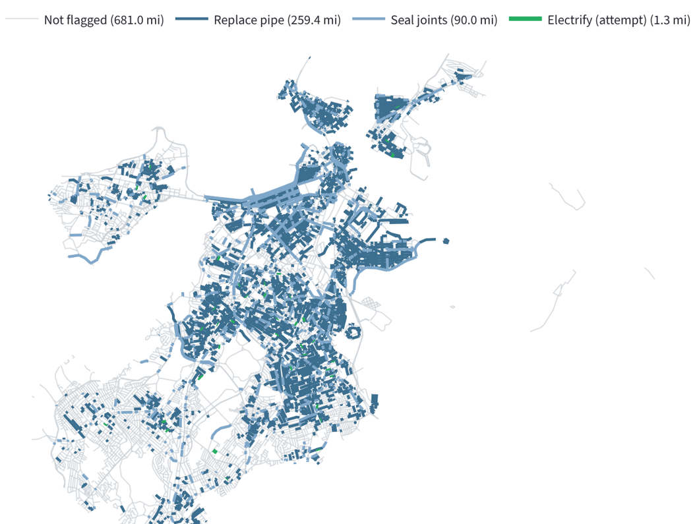
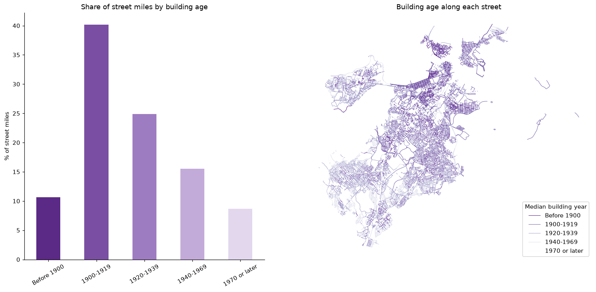
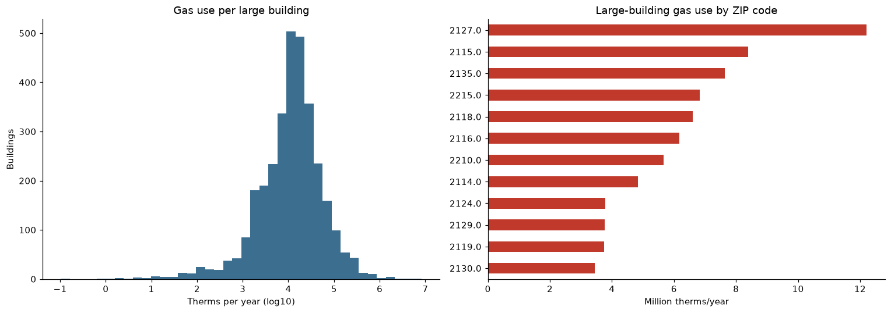
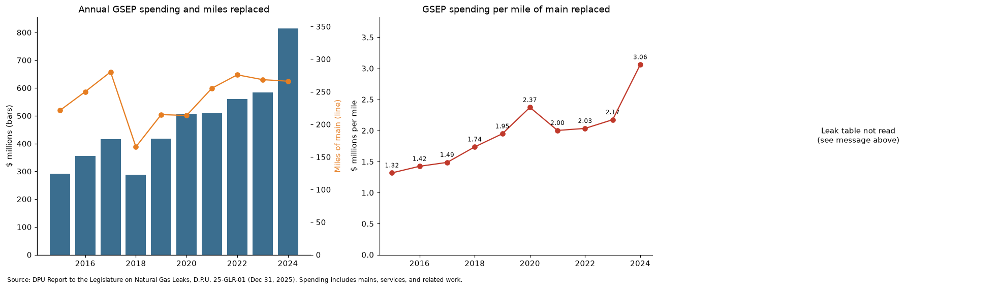

# Repair, Replace, or Retire? Boston Gas Pipe Triage

**A street-by-street analysis of Boston's leak-prone gas mains: where the old pipe likely is, and whether replacing it, sealing it, or retiring it in favor of heat pumps costs less, once the gas network, owner consent, timing, and crew capacity are counted.**

Created by **Cathy Kam** · Built entirely from public data

🔗 **Live app:** [Open the interactive app](https://boston-gas-triage-kljspjcnsvm6y8pc8uv3sp.streamlit.app/)

📊 **Dashboard:** [Explore the findings](https://claude.ai/artifact/NCBbcS6BsYTT21bcS8yUa5)

🎬 **One-minute story:** [Watch the animated walkthrough](https://claude.ai/artifact/PD3uwEsXNGmZqpsz9XKT6a)

---

## Why this project

Underneath Boston's streets are hundreds of miles of gas mains made of cast iron and unprotected steel, much of it laid more than a century ago. These pipes are prone to leaking methane, a potent greenhouse gas, and to safety hazards.

Since 2015, Massachusetts has paid to replace them through the **Gas System Enhancement Program (GSEP)**. According to the Department of Public Utilities' (DPU) annual report to the Legislature:

- From 2015 to 2024, gas utilities spent about **$4.75 billion** to replace about **2,411 miles** of leak-prone mains, recovered through customers' gas bills.
- Spending per mile rose from **$1.32 million in 2015 to $3.06 million in 2024**, while the number of miles replaced each year stayed roughly flat.
- Open leaks across the state fell from **20,775 (2014) to 9,077 (2024)**, a 56% drop. The program worked on leaks, at a rising cost.

In 2025, DPU cut the program's spending cap and directed utilities to consider cheaper repairs and **non-pipe alternatives**, such as electrifying the homes on a street instead of laying new gas pipe. Yet of 500 alternative projects the utilities reviewed for 2026, none were judged viable.

**This project asks, for every flagged street in Boston: which way of making it safe costs least, and how firm is that answer?** It compares three options on equal terms (replace the pipe, seal its joints, or electrify the homes) and is meant to stay neutral between them.

| Money spent per year | Miles replaced per year |
|---|---|
|  |  |

---

## Key findings

All figures use the app's default settings (capital cost, central estimates).

1. **About 351 miles of Boston streets are likely on leak-prone pipe.** Replacing all of it at the latest statewide cost would take about **$1.07 billion** in capital.
2. **The tipping point is about 8.6 homes per 100 meters of street.** Below that density, heat pumps for every home (about $22,000 each) cost less than new pipe. On lifetime cost to customers it is 5.6.
3. **On cost alone, electrification wins on about 33 of the 351 miles** (about 2,560 homes). The typical old street with homes has about 18 homes per 100 m, and 82% of that mileage sits above the tipping point.
4. **The gas network narrows this sharply.** A main can only be retired if no customer further along still uses gas. About 93% of flagged miles are through streets. Of the 33 cost-alone miles, about **1.5** are on dead-end branches that could come off gas as a unit.
5. **Consent narrows it further.** Every property owner on a branch has to agree. The plan tries electrification on **39 short branches (1.3 miles, 110 homes, 99 owners)**; with an average 39% chance that everyone agrees, about **0.5 miles** is expected to come off gas.
6. **Pipe work is the lower-cost option on most streets:** replacement on 259 miles and joint sealing on 90 miles of major roads. The plan's expected cost is **$1.02 billion, 5% less** than replacing everything. At $50M a year and 17 crew-miles, falling with DPU's spending cap, it takes about **28 years**, highest-risk streets first.
7. **Most choices are firm, and the close calls are where pilots would help most.** With cost ranges of ±20% (replace), ±30% (electrify), and ±40% (seal), choices hold on 349 miles. On **62 dead-end branches (2.2 miles)**, pipe work and electrification could swap places; these are listed in the app as pilot candidates.
8. **Equity:** 92% of the miles where electrification is attempted are in environmental-justice neighborhoods, so any program there would need income-qualified support and protections for renters.
9. **Large-building gas use is highly concentrated.** Among 5,580 large buildings reporting to the city, the top 10% use **73%** of the gas.



---

## How it was built

The project has four parts, one notebook each, plus the app.

### Part 1: Data extraction and cleaning

Every source is pulled programmatically and joined to **17,820 Boston street segments (about 1,030 miles)**.

| Data | Source | Used for |
|---|---|---|
| Street segments with house-number ranges | City of Boston open data (SAM) | Unit of analysis; address matching |
| FY2026 property assessment (185,000 parcels) | City of Boston open data | Building age, housing units, heat pumps |
| Building energy reports (5,580 buildings) | City of Boston BERDO | Metered natural gas use |
| Heating fuel, housing age, income, tenure | U.S. Census ACS 5-year (2024) | Neighborhood context, 681 block groups |
| Block group boundaries | U.S. Census TIGERweb | Linking Census data to streets |
| Environmental-justice block groups | MassGIS (2020) | Equity analysis |
| Daily weather since 2000 | Open-Meteo | Freeze-thaw cycles, heating degree days |
| GSEP spending, miles, leak counts | DPU report D.P.U. 25-GLR-01 | Costs, calibration, program history |

Buildings were placed on streets by matching each address to the segment whose house-number range contains it, with a **96% match rate**.

### Part 2: Exploratory analysis

- Building age along each street as a proxy for the age of the gas main underneath
- Gas heating dependence and how it relates to older housing
- Equity comparisons between environmental-justice and other neighborhoods
- Concentration of large-building gas demand
- The GSEP record: spending, miles, cost per mile, and leaks over time

| Building age along each street | Large-building gas use |
|---|---|
|  |  |



### Part 3: Modeling

- **Street segmentation (k-means clustering).** Streets were grouped into six types using building age, housing density, large-building gas use, gas heat share, renter share, income, and heat pump share.
- **Leak-prone risk score.** Streets were ranked by building age, with the share flagged calibrated to the leak-prone share of Boston Gas's mains reported by DPU (34%). A gradient-boosting model is built in and switches on automatically when leak records are added, then is tested on a held-out year.
- **The gas network** (`network_units.py`). The full city street network (19,440 segments) is turned into a graph. Dead-end branches are found by peeling off dead ends repeatedly, then whole branches are grouped together. A branch is treated as connected if a dead end comes within 30 m of another street (a possible easement or path) or sits at the city line. Of 1,875 dead-end branches, 1,127 could come off gas as a unit. Connected segments of the same street become one construction project.
- **Three options per street.** Replace; seal joints and replace later (major roads only, discounted); or electrify. Electrification is decided for a whole dead-end branch, at an expected cost that includes the chance every owner agrees, the pipe work needed if anyone declines, and leak repairs during the lead time.
- **A schedule, not a ranking.** Work is placed year by year within both the budget and crew capacity, highest-risk 10% first, with the budget following DPU's falling cap.
- **Uncertainty and readiness.** Each option has a cost range, wider where there is less real-world data, and a readiness rating. The model reports which choices are close calls within those ranges. Options can be compared at central estimates or all at their high estimates, and the same rule applies to every option.
- **Horizon and financing.** Under lifetime cost, the analysis horizon and credit for remaining asset life can be changed, and heat pumps can be financed through rates like pipe, so that differences in how options are paid for don't decide the comparison.

### Part 4: Interactive app

A Streamlit app where anyone can:

- Change every assumption: heat pump cost, consent rates, lead times, sealing, budget, crew capacity, cost ranges, horizon, and financing
- See a live map of every flagged street, colored by lower-cost option, network position, plan year, or pilot candidates, with hover details and a neighborhood filter
- Follow the funnel from cost alone to what's realistic, and see how firm each choice is
- Browse the readiness table, the year-by-year schedule, and the pilot candidates
- Download the priority list as a CSV

---

## Limitations

- **The risk score is provisional.** It is based on building age until street-level leak records are added.
- **Costs are statewide averages.** Boston's dense urban streets may cost more or less per mile.
- **The gas network is approximated** from the city's street map, not the utility's main maps.
- **Some costs are left out on every side:** future leak repairs on new pipe; panel, grid, and weatherization upgrades for heat pumps; monthly bills. The net direction of these omissions is uncertain.
- **Several inputs are assumptions,** including cost ranges, the chance a landlord agrees, and lead times. All are labeled and adjustable in the app.

## Next steps

- Add street-level leak records to replace the provisional risk score with a trained, tested prediction model
- Update the readiness table and cost ranges as pilots report, ideally from a shared public repository of pilot results
- Mark streets already replaced under GSEP, using project lists from the utilities' public filings
- Add methane avoided for each plan, using EPA emission factors by pipe material

---

## Project structure

```
boston-gas-triage/
├── app.py                          # Part 4: Streamlit app
├── network_units.py                # gas network: dead-end branches and street projects
├── requirements.txt
├── .streamlit/config.toml          # app theme
├── 01_data_extraction_cleaning.ipynb
├── 02_EDA.ipynb
├── 03_Modeling.ipynb
├── figures/                        # charts used in this README
├── scripts/keep_awake.py           # visits the live apps so they don't sleep
├── .github/workflows/keep-awake.yml  # runs keep_awake.py every 6 hours
└── data_processed/
    ├── segments_scored.geojson     # from Part 3
    ├── plan_summary.json           # from Part 3
    └── gsep_annual.csv             # from Part 2
```

## Run locally

```bash
pip install -r requirements.txt
streamlit run app.py
```

The notebooks rebuild everything from scratch: run Part 1, then Part 2, then Part 3. Raw downloads are saved to `data_raw/`, which is not included in this repository.

## Data sources

- Massachusetts DPU, *Report to the Legislature on the Prevalence of Natural Gas Leaks*, D.P.U. 25-GLR-01 (December 31, 2025)
- Massachusetts DPU, GSEP Working Group meeting minutes (October 20, 2023) and GSEP orders (April 30, 2025)
- Joint sealing: ENR and ULC Technologies (Con Edison and Cadent examples)
- Owner consent rate: Eversource Framingham networked geothermal pilot
- OpenStreetMap contributors (map background)
- City of Boston Open Data: Boston Street Segments (SAM), FY2026 Property Assessment, Building Emissions Reduction and Disclosure Ordinance (BERDO) reporting
- U.S. Census Bureau: American Community Survey 5-year estimates (summary file) and TIGERweb block group boundaries
- MassGIS: 2020 Environmental Justice Populations
- Open-Meteo historical weather archive

---

*Built with public data only. This is an independent portfolio project, not an official DPU or utility analysis.*
